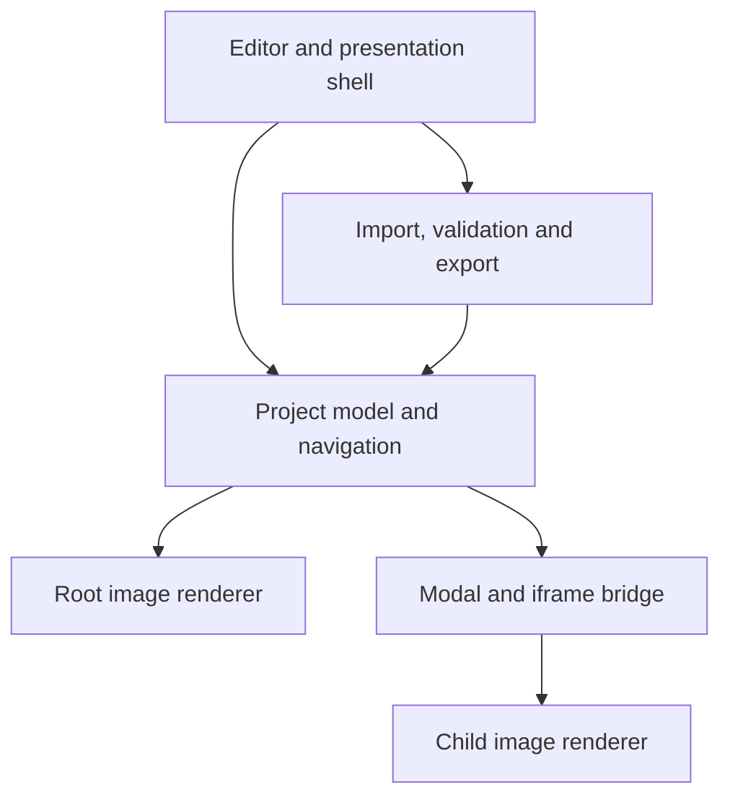

# Portable Diagram Explorer — product and technical specification

Version: 0.1 · Date: 6 November 2026 · Status: proposed specification; application not yet implemented

## 1. Recommendation and feasibility

Build a small, browser-based application in JavaScript, HTML and CSS. Authors import existing diagram images, draw clickable regions over components, assign child diagrams and descriptive text, and export a presentation that runs offline. No Python, Node.js, account, cloud service or application installation should be required by recipients on supported desktop browsers.

JavaScript is the recommended runtime because the browser already provides rendering, interaction and file import. Python could provide an optional local server or packaging utility later, but making it mandatory would reduce portability. A framework is unnecessary for the first version. A locally bundled ZIP library is acceptable; there must be no runtime CDN dependency.

Preserve original images and store hotspots separately. Editing a hotspot must never redraw, regenerate, crop or otherwise change the source image. The app adds navigation and annotation to existing diagrams; the first version does not create the architecture drawings themselves.

The requested iframe approach is feasible. Use one reusable iframe inside a modal, with navigation managed by the parent application. Do not create another iframe or browser window at every drill-down level.

## 2. Portability of the previously discussed tools

| Tool | Documented portability | Implication for this requirement |
| --- | --- | --- |
| Figma | Prototypes can be preloaded online and presented offline while the presentation tab stays open. Closing it requires preloading again. Offline playback is not supported on mobile. | Offline presentation is available, but this documented mechanism is not an independently transferable HTML presentation. |
| Prezi | Portable presentations can be downloaded for offline sharing/presentation; the desktop apps are for Windows/macOS and require a paid plan. | Some portability exists, but it is not the same deployment model as an open HTML/JSON/images package. Check the intended recipient platform. |
| Genially | Premium HTML downloads retain interactivity and can run from an extracted folder; internet-dependent embeds remain online-dependent. Documentation excludes mobile/tablet playback for this HTML download route. | Closest documented export, but windows cannot directly open windows from elements inside them, limiting the requested recursive modal interaction. |
| IcePanel | Exports include JSON model data and SVG/PNG/PDF diagrams. | These preserve model/data or drawings; the documented exports are not evidence of a standalone offline interactive viewer. |

These conclusions concern the documented product features, not unofficial third-party exporters. Product plans and capabilities can change. Sources are listed in section 16.

## 3. Goals and boundaries

### Required in version 1

- Import PNG, JPEG and WebP diagram images as files.
- Create, move, resize, duplicate and delete rectangular hotspots.
- Assign a hotspot to one or more existing diagrams and/or a text description.
- Show a short tooltip on hover and keyboard focus.
- Open a child diagram in a modal containing an iframe.
- Support further clickable regions inside child diagrams.
- Offer a component menu with choices such as Open HLD, Open LLD and Read description.
- Support in-app Back, breadcrumbs, Overview and Close, with viewport restoration.
- Pan, zoom, fit-to-view and fullscreen presentation where supported.
- Provide editor and presentation modes, undo/redo, validation and explicit save/export.
- Export an editable package with separate image files, and a self-contained HTML presentation.
- Run the core desktop workflow offline without a server, login or installation.

### Outside version 1

Live collaboration, authentication, cloud synchronization, AI image editing, drawing connectors, arbitrary third-party webpage embedding, source-code execution, automatic architecture extraction, PDF rendering, and video/audio authoring. SVG import and polygon hotspots can be subsequent additions after a dedicated handling policy. Rectangles are sufficient for the first usable release.

## 4. Main user workflows

### Author a project

1. Open the self-contained editor HTML file.
2. Create a named project and import the overview and supporting image files.
3. Give each diagram a title and optional description; choose the overview.
4. Select Add hotspot and drag over a component on the image.
5. Enter a label and hover text. Assign a default child diagram, a description, or multiple labelled actions.
6. Open the child diagram in the editor and add its hotspots in the same way.
7. Preview the complete hierarchy, run validation, and export.

### Present a project

1. Double-click the exported presentation HTML in a supported desktop browser.
2. The overview appears without editor controls.
3. Hover or focus a component to see its tooltip.
4. Click to perform its default action, or display its action menu when no default is defined.
5. The modal opens with the selected child diagram. Other hotspots can be explored within the same modal.
6. Back returns one step; breadcrumbs return to an earlier level; Close returns to the overview with its previous zoom and pan intact.

### Continue editing on another computer

Open the editor and select the editable project ZIP. The editor reads its JSON and images through the user-selected file, reconstructs the project, and permits further editing. An exported presentation should also contain the canonical project data and asset bytes so the editor can offer an Import presentation operation. Hiding editing controls is a convenience, not access control or protection against copying.

## 5. User interface and interaction contract

| Area | Behaviour |
| --- | --- |
| Project sidebar | Searchable diagram list, titles, thumbnails, root indicator and reference counts. |
| Canvas | Image plus aligned hotspot layer. Editing outlines and handles are hidden in presentation mode. |
| Inspector | Selected hotspot label, tooltip, geometry, description and ordered action list. |
| Presentation toolbar | Back, breadcrumbs, Overview, Fit, zoom controls, hotspot hints and fullscreen. |
| Modal | One iframe renderer, title, breadcrumb trail, Back, Close and optional details panel. |
| Status | Unsaved changes, validation problems, export completion and missing assets. |

Interaction rules:

- Left-click runs the explicit default action. With several actions and no default, it opens the component menu. With only a description, it opens the details panel.
- Right-click on a hotspot opens the custom component menu. Shift+F10 or the context-menu key offers the keyboard equivalent. Elsewhere, retain the browser menu.
- A visible menu button provides the same choices on touch devices and for users who do not discover right-click.
- Tooltip delay defaults to 350 ms, is configurable, and disappears on movement away, activation or Escape. Text is also available through focus or the details action.
- Tab moves between hotspots and controls; Enter/Space activates. Escape first dismisses a menu/tooltip, then the details panel, then the modal. Escape never destroys edits.
- Pan using drag on empty canvas or Space+drag. Hotspot drag moves a region only in editor mode. Movement beyond a small threshold suppresses accidental activation.
- Wheel/pinch zoom is anchored at the pointer; explicit +/− and Fit buttons provide alternatives. Do not disable the browser's accessibility zoom shortcuts.
- Root imagery stays visible behind a dimmed modal. Details are readable plain text in version 1, including preserved line breaks. Visible text annotations can be placed on each diagram separately from hover tooltips.
- Overlapping hotspots have explicit z-order; the visually topmost hotspot receives activation. Provide an editor warning for completely obscured regions.
- Changing a source image preserves hotspots but warns when dimensions/aspect ratio differ and requires reviewing alignment before export.

## 6. Navigation model

Treat diagrams as a graph rather than a strict tree. A shared service diagram can be opened from several parent diagrams, and a component can offer both an HLD and an LLD. Stable diagram IDs identify targets. The current navigation path supplies the breadcrumbs; a diagram does not require a single parent ID.

The parent app owns a navigation stack. Each entry records scene ID, viewport centre in normalized image coordinates, zoom relative to fit, selected hotspot and details-panel state.

1. Opening the first child captures the overview state and creates the modal/frame.
2. Opening a deeper diagram captures the current child state, pushes the target and replaces the frame's scene.
3. Back pops the current entry and restores the prior scene and viewport. At the first child, Back closes the modal and restores the overview.
4. Selecting an ancestor breadcrumb truncates the stack and restores that entry.
5. Close/Overview closes the modal, discards the drill-down stack and restores the overview state.
6. Resizing recomputes fit scale and keeps the saved image-centre location visible.

Cross-links and cycles are allowed. Breadcrumb entries have visit IDs as well as diagram IDs so revisiting the same diagram is unambiguous. Cap active history at 64 visits; on reaching the cap, show a clear choice to return earlier or reset navigation. There is no small fixed diagram nesting limit. Browser Back behaviour is outside the initial contract; the in-app Back control is authoritative.

## 7. Rendering and hotspot coordinates

Use an HTML image element with an SVG interaction layer sharing a single transformed image-space container. Keep image pixels, annotations and hotspot geometry in the same coordinate system; do not independently position overlays against the outer viewport.

Persist rectangular geometry as normalized fractions of the natural image size:

- x and y: top-left position in the range 0 to 1.
- width and height: positive fractions; x + width and y + height must not exceed 1.
- All values must be finite numbers.

For natural image dimensions W and H, a hotspot is positioned at (xW, yH) with size (widthW, heightH). Fit scale is min(availableWidth/W, availableHeight/H). Display scale is fit scale multiplied by user zoom. Screen coordinates are translation plus display scale times image coordinates. Pointer editing uses the inverse of that same transform; clamp shapes to the image bounds.

Measure the actual displayed image rectangle, including letterboxing. Normalize image orientation at import and persist the effective dimensions. An image's ID is independent of its filename. Several diagrams can use one asset with different hotspots and annotations. Zooming a raster image enlarges its pixels; deeper views require separate detailed images for additional information.

## 8. Application architecture and iframe design



Recommended modules:

| Module | Responsibility |
| --- | --- |
| ProjectStore | Validated diagrams, assets, hotspots, annotations and schema version. |
| AssetManager | Read selected files, decode images, resolve asset IDs, manage temporary URLs and release resources. |
| SceneRenderer | Shared image/overlay transforms, hit handling, tooltips, pan and zoom. |
| EditorController | Region drawing, selection, inspector changes and bounded undo/redo history. |
| NavigationController | Visit stack, viewport snapshots, breadcrumbs and popup lifecycle. |
| FrameBridge | Narrow message protocol between parent shell and trusted child renderer. |
| PackageIO | ZIP import/export, portable HTML generation and schema migration. |
| Validator | Structural checks, target/asset references, geometry and actionable errors. |

The renderer code is authored once and bundled for use in both contexts. The modal iframe is created with a trusted srcdoc template, not an imported HTML page. It renders a scene from data sent by the shell. The shell keeps menus, breadcrumbs and history authoritative. The child sends activation and viewport events to the shell rather than independently navigating to arbitrary URLs.

Messages use a versioned protocol, for example READY, RENDER_SCENE, SCENE_READY, ACTIVATE_HOTSPOT, VIEWPORT_CHANGED and REQUEST_BACK. Validate message type, fields, active frame session and sequence. Accept activation only for hotspots belonging to the currently displayed scene; resolve target IDs from the parent model, not from arbitrary child-provided URLs. Throttle viewport messages and ignore stale responses after navigation.

Sandbox the iframe with allow-scripts only; do not grant same-origin, top navigation, popups or forms. Under this sandbox, origin may be opaque. Use exact event.source checks and an unguessable per-frame channel ID, and validate payloads. Where an opaque receiver requires targetOrigin '*', send only to the already-created frame.contentWindow; never broadcast. Child messages must come from its parent. A matching 'null' origin alone is not authentication.

For the portable export, pass the current image as a data URL rather than relying on the iframe to fetch local files. Apply a restrictive content policy to the frame, allow only bundled renderer code and embedded image bytes, and block network access. Keep imported text out of executable templates. This avoids requiring same-origin access between local-file frames. Verify this design in the browser compatibility spike before building the full editor.

## 9. Canonical data model

The editable package contains a UTF-8 project.json and separate asset files. IDs are opaque, stable strings. They do not encode parentage or depend on filenames.

Illustrative valid project:

```json
{
  "schemaVersion": 1,
  "projectId": "p-demo",
  "title": "Customer Platform",
  "rootDiagramId": "d-overview",
  "assets": [
    {"id": "a-overview", "path": "assets/overview.png", "mimeType": "image/png", "width": 1920, "height": 1080},
    {"id": "a-identity", "path": "assets/identity.png", "mimeType": "image/png", "width": 1920, "height": 1080},
    {"id": "a-mapping", "path": "assets/mapping.png", "mimeType": "image/png", "width": 1600, "height": 1000}
  ],
  "diagrams": [
    {
      "id": "d-overview",
      "title": "Platform overview",
      "assetId": "a-overview",
      "description": "Main systems and their connections.",
      "hotspots": [
        {
          "id": "h-identity",
          "label": "Identity service",
          "tooltip": "Authentication and account association",
          "rect": {"x": 0.2, "y": 0.25, "width": 0.18, "height": 0.12},
          "zIndex": 1,
          "defaultActionId": "open-identity",
          "actions": [
            {"id": "open-identity", "label": "Open HLD", "type": "diagram", "targetDiagramId": "d-identity"},
            {"id": "identity-details", "label": "Read description", "type": "details", "text": "Authenticates users and resolves their permitted accounts."}
          ]
        }
      ],
      "annotations": []
    },
    {
      "id": "d-identity",
      "title": "Identity service HLD",
      "assetId": "a-identity",
      "description": "Authentication and account lookup.",
      "hotspots": [
        {
          "id": "h-mapping",
          "label": "Account association",
          "tooltip": "Open the detailed association design",
          "rect": {"x": 0.45, "y": 0.3, "width": 0.2, "height": 0.15},
          "zIndex": 1,
          "defaultActionId": "open-mapping",
          "actions": [
            {"id": "open-mapping", "label": "Open LLD", "type": "diagram", "targetDiagramId": "d-mapping"}
          ]
        }
      ],
      "annotations": [
        {"id": "n-lookup", "text": "Account IDs come from the internal system.", "x": 0.05, "y": 0.85, "width": 0.4}
      ]
    },
    {
      "id": "d-mapping",
      "title": "Account association LLD",
      "assetId": "a-mapping",
      "description": "Detailed identity-to-account relationship.",
      "hotspots": [],
      "annotations": []
    }
  ],
  "settings": {"tooltipDelayMs": 350, "showHotspotHints": true}
}
```

Action types in version 1 are diagram and details. An absent or null defaultActionId means show the menu; a non-null default must identify an action on that hotspot. Annotation positions and width are normalized; text height is automatic and bounded by the image area. Version 1 uses one bundled, consistent text style. Dates and optional author metadata may be added but are not identity keys.

Ship a JSON Schema defining required properties, enums, ranges, length limits and object types. Add semantic validation for unique IDs, reference integrity and image dimensions. Reject unsupported future schema versions with an explanatory error; migrate older supported versions explicitly. Reject unknown executable/action types rather than interpreting them dynamically.

## 10. File formats, saving and offline operation

### A. Editable project package: name.diagram.zip

| Entry | Contents |
| --- | --- |
| project.json | Canonical, readable metadata and hotspot definitions. |
| assets/ | Original PNG/JPEG/WebP files, with unique safe filenames. |
| editor.html | Versioned, self-contained editor; opens without downloading code. |
| README.txt | How to open editor.html and select the project ZIP; format/runtime version. |

The ZIP is the authoritative saved project. After extracting it, authors can also select project.json and all referenced images together using the standard file picker. Match package-relative paths where directory selection is available; otherwise use the unique safe asset filenames. Exported asset names must be unambiguous. Do not silently match two files sharing a basename.

### B. Portable presentation: name.presentation.html

One file containing the viewer runtime, CSS, canonical project data and embedded image bytes. A recipient double-clicks it and presents offline. This is the primary no-install distribution format and the most robust answer to local-file restrictions. Base64 encoding adds roughly one-third to binary asset size, and decoded image memory can be much larger than compressed file size. Warn authors when the project exceeds the validated export envelope.

The project data remains declarative JSON, not an executable project.js. Escape '<' and script-closing sequences when embedding JSON in HTML, and parse it as data. Runtime code is trusted bundled application code. Do not execute imported scripts or use eval.

### Why not just fetch project.json from index.html?

Browser treatment of file:// origins varies and can prevent local fetch requests and frame access. Therefore version 1 must use standard user-selected File/Blob input for editable projects and embedded data for exported presentations. Folder-based static hosting can be added later; the core workflow must not require a local server, disabling browser security or changing browser flags.

### Save rules

- Save Project downloads a new project ZIP. Export Presentation downloads the self-contained HTML.
- The browser is not assumed to overwrite arbitrary source files. Optional direct-save support may be added where the File System Access API is available; it is not a baseline requirement.
- Mark changes dirty until an export is generated. Explain that the browser controls the final download location and cannot universally confirm that the file was retained.
- Provide an unsaved-changes indicator and a best-effort leave warning. Browser-local autosave may be a later recovery convenience; it must never be the only saved copy.
- No dependency on localStorage, IndexedDB, service workers, internet fonts, analytics or remote images for successful playback.
- MIME-validate imported assets, normalize their names and keep relative paths portable. No absolute user-machine paths in saved packages.

## 11. Safety, privacy and accessibility requirements

- Project content stays on the device unless the author deliberately transfers or hosts the exported file. Core operation makes zero network requests.
- Accept ZIP/JSON/image data only. Reject traversal paths, absolute paths, duplicate package entries, unexpected executable entries, excessive extracted sizes and unsupported image formats.
- Ignore any editor.html supplied by an imported package when importing its data; continue using the already-open trusted editor runtime.
- Render descriptions as text, never raw HTML. SVG and arbitrary HTML imports are excluded from version 1 to keep the executable-content boundary small.
- Permit no arbitrary iframe URLs, javascript: actions, remote image sources or hidden browser navigation in project data.
- Give the iframe an accessible title. The modal traps focus, makes background controls inert and restores focus to the originating hotspot on close. Menus support keyboard navigation and Escape.
- Provide accessible hotspot labels, focus indicators, sufficient contrast and a keyboard-accessible hotspot list for very small regions. Mouse hover must not be the only route to information.
- Close and Back remain usable when focus is inside the frame. Implement explicit messages for relevant shortcuts and test them across browsers.

## 12. Performance and compatibility targets

These are proposed acceptance targets, not measured capabilities of an existing implementation.

| Target | Initial test envelope |
| --- | --- |
| Browsers | Current stable Chrome, Edge, Firefox and Safari at implementation time; verify exact versions. |
| Desktop platforms | Windows and Linux with supported browsers; macOS including Safari. |
| Presentation project | 50 diagrams, 1,000 hotspots total, up to 100 hotspots on a scene, up to 50 MiB compressed image bytes. |
| Individual raster | Warn above 4096 × 4096 pixels; impose a documented decoded-pixel limit during import. |
| Responsiveness | Target smooth pan/zoom; warm navigation under 300 ms and initial open under 5 s on a recorded reference laptop, excluding file-selection time. |
| History | At least 10 tested drill-down visits; bounded maximum 64 active visits. |
| Mobile/tablets | Touch-compatible controls are designed in; direct file opening/import is a separate compatibility gate, not a version 1 portability promise. |

Lazy-decode the active scene and a small number of nearby scenes. Reuse original asset bytes; do not keep every diagram decoded or create a growing iframe tree. Release temporary URLs and frame resources on replacement and project close. Report timings, peak memory and browser versions during validation. Adjust advertised project limits from measured results.

## 13. Acceptance scenarios

| ID | Test and required outcome |
| --- | --- |
| A01 | On an offline second computer, open the presentation HTML from a different folder. All images, hotspots, notes and navigation work without server/install/network requests. |
| A02 | Open editor.html via file://, import the sample project ZIP, edit a hotspot, save, reopen and compare. IDs, text, targets, coordinates and original asset bytes are preserved. |
| A03 | Traverse overview → HLD → LLD → another detail view, then Back twice. Each prior image centre, zoom, selection and details state is restored. |
| A04 | Open one shared diagram from two different components. Breadcrumbs and Back reflect the actual route for each visit. |
| A05 | Resize the window, zoom and pan. Hotspots remain aligned with their image regions at every scale, including letterboxed layouts. |
| A06 | Right-click a hotspot, use the menu button and use Shift+F10. The same actions are available. Native right-click still works outside hotspots. |
| A07 | Use keyboard only to explore, read descriptions and close the popup. Focus is visible, trapped appropriately and returned to the triggering hotspot. |
| A08 | Activate a hotspot in the iframe, navigate quickly and resize. Stale frame messages cannot change the new scene; global Back/Close remain effective. |
| A09 | Supply a missing asset, dangling target, corrupt ZIP or future schema. Show an actionable validation error without silently losing content. |
| A10 | Insert HTML-like annotation text and crafted frame messages. Text remains inert; unauthorized or invalid messages are rejected. |
| A11 | Replace an image with a different aspect ratio. Warn and require alignment review; never silently claim the overlays still match. |
| A12 | Create a cross-link cycle and traverse it. Navigation remains responsive, history limits are enforced and Overview always exits. |
| A13 | Hide hotspot hints and run presentation mode. No editing handles appear; tooltips, menus and keyboard access still work. |
| A14 | Open the maximum-envelope project on the reference machine. Record initial load, warm navigation, pan/zoom and peak memory; document any revised limits. |

Run offline-open, iframe navigation and save/reopen tests in every claimed desktop browser, not only Chromium. If direct file:// support fails in a browser, fix the packaging or explicitly narrow the support matrix; do not silently replace the no-install requirement with a server dependency.

## 14. Implementation sequence

1. **Portability spike:** create a tiny self-contained HTML with three sample images, one sandboxed iframe, nested navigation messages, file import and HTML download. Verify offline file:// opening in the target browsers. This resolves the highest-risk assumption first.
2. **Viewer:** project validation, scene renderer, normalized regions, hover/focus text, component menus, viewport snapshots and reusable modal.
3. **Editor:** image import, hotspot tools, actions, descriptions, annotations, diagram management, undo/redo and broken-link handling. Referenced diagram deletion requires explicit retarget/remove decisions and remains undoable.
4. **Packaging:** deterministic asset naming, editable ZIP, self-contained presentation, project/presentation import and export-size warnings.
5. **Verification and polish:** browser matrix, accessibility, offline/malformed-content tests, measured limits, README and a sample project.

Viewer code can stay small. A reliable graphical editor and correct import/export will take more work than the popup itself. Do not commit a calendar estimate before the portability spike and a simple editor slice are complete.

## 15. Definition of done

Deliver the self-contained editor, an editable three-level sample package, its portable HTML presentation, the source code, schema, README and a short browser/acceptance report. Preserve the original input images exactly. A recipient must be able to open the presentation without the author being present, and another author must be able to reopen the package and change a hotspot without rebuilding the application.

Recommended first release: JavaScript, raster images, rectangular hotspots, plain-text descriptions, one modal iframe, parent-owned navigation and the two explicit export formats. Add polygon regions, Markdown, direct folder editing and richer architecture metadata only after this core workflow is proven.

## 16. References

Product documentation consulted on 6 November 2026:

- [Figma: Present prototypes offline](https://help.figma.com/hc/en-us/articles/26463081577367-Present-prototypes-offline)
- [Prezi: Present FAQ](https://support.prezi.com/hc/en-us/articles/360003478254-Prezi-Present-FAQ)
- [Prezi: Desktop downloads](https://prezi.com/download/)
- [Genially: HTML download](https://help.genially.com/en_us/how-to-download-a-genially-as-html-to-embed-it-on-another-website-SJ2U5vr2s)
- [Genially: Windows and nesting restrictions](https://help.genially.com/en_us/how-to-create-and-edit-windows-SkEpA0QUn)
- [IcePanel: Exports](https://docs.icepanel.io/core-features/export)
- [MDN: Local-file CORS restrictions](https://developer.mozilla.org/en-US/docs/Web/HTTP/Guides/CORS/Errors/CORSRequestNotHttp)
- [MDN: Same-origin policy and file origins](https://developer.mozilla.org/en-US/docs/Web/Security/Defenses/Same-origin_policy)
- [MDN: Using files from web applications](https://developer.mozilla.org/en-US/docs/Web/API/File_API/Using_files_from_web_applications)
- [MDN: showDirectoryPicker compatibility](https://developer.mozilla.org/en-US/docs/Web/API/Window/showDirectoryPicker)
- [MDN: iframe](https://developer.mozilla.org/en-US/docs/Web/HTML/Reference/Elements/iframe)
- [MDN: postMessage](https://developer.mozilla.org/en-US/docs/Web/API/Window/postMessage)

The application architecture, data format, scope and acceptance targets above are proposed engineering decisions; they have not been implemented or benchmarked by this specification.
